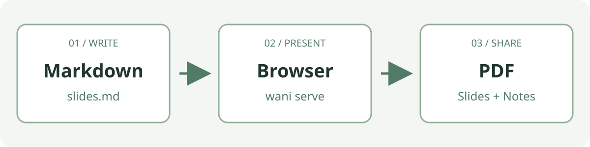

# はじめての Wani

Ruby と Markdown でプレゼンテーション。

- 左右キー・Space で移動
- F で全画面
- N で発表者ノート

<!-- page-footnote: Wani のサンプルへようこそ -->

<!-- notes:
最初に自己紹介をします。
ページを進めながら使える記法を紹介します。
原稿の先頭にある time_limit は発表時間（分）です。0 にするとタイマーを無効にできます。
-->

---

# 文章を強調する

**いちばん伝えたいこと**は太字にします。

*強調したい言葉*はアスタリスクで囲みます。

コマンドは `wani serve` のように文中に入れられます。

空行を入れると、新しい段落になります。

<!-- notes:
原稿では **太字**、*強調*、バッククォートで囲むコードを使っています。
タイトルはプレーンテキストになります。本文で表示の違いを見せます。
-->

---

# リストで整理する

- 原稿は Markdown で書く
- 画像は images フォルダーに置く
- ブラウザーで見た目を確認する

1. `wani check` で原稿を確認する
2. `wani serve` でサーバーを起動する
3. 表示された URL を開く

<!-- notes:
上は箇条書き、下は番号付きリストです。
原稿を編集したらブラウザーを再読み込みします。
-->

---

# 引用とリンク

> 一枚のスライドでは、一つのメッセージを伝えよう。

参考資料は [Ruby の公式サイト](https://www.ruby-lang.org/ja/) のようにリンクできます。

`[表示する文章](URL)` がリンクの書き方です。

<!-- page-footnote: リンクはクリックして開けます -->

<!-- notes:
引用は行頭に > を付けて書きます。
この引用文は書き方を紹介するためのサンプルです。
-->

---

# コードを見せる

```ruby
topics = ["Markdown", "Ruby", "WebAssembly"]

topics.each do |topic|
  puts "Hello, #{topic}!"
end
```

複数行のコードはバッククォート3つで囲みます。

<!-- notes:
フェンスに ruby と言語名を書けますが、構文ハイライトは行いません。
コード内の記号や改行はそのまま表示します。
-->

---

# 表で比較する

| 書きたいもの | Markdown の記法 |
| --- | --- |
| ページのタイトル | `# タイトル` |
| 太字 | `**太字**` |
| 文中のコード | バッククォートで囲む |
| 次のページ | 空行を挟んだ `---` |

<!-- notes:
表の見出しの次に、ハイフンで区切りの行を書きます。
行数が多いときは、スライドを分けて読みやすくします。
-->

---

# 画像で伝える



`` で画像を表示します。

<!-- page-footnote: サンプル画像は images/workflow.svg にあります -->

<!-- notes:
この図は wani new で原稿と一緒にコピーされる SVG です。
PNG、JPEG、WebP も使えます。自分の画像を images フォルダーに置いて差し替えてください。
パスは slides.md の場所を基準に書きます。
-->

---

# 発表者ノートを書く

```markdown
<!-- notes:
**デモの前に**、操作の流れを説明します。
-->
```

N キーで、このページの実際のノートを確認できます。
ノートは発表者画面とノート付き PDF に表示します。

<!-- notes:
**デモの前に**、操作の流れを説明します。
これは発表者向けの補足です。通常のスライド本文には表示されません。
-->

---

# ページに脚注を付ける

```markdown
<!-- page-footnote: 出典：Wani サンプル資料 -->
```

このページの下部に、実際の脚注を表示しています。
出典や補足を、そのページだけに付けられます。

<!-- page-footnote: 出典：Wani サンプル資料 -->

<!-- notes:
コード欄は書き方の見本で、下部の脚注は実際のコメントから表示しています。
脚注はプレーンテキストです。PDF にも表示されます。
-->

---

# 発表と配布へ

- N キーで、このページの発表者ノートを開く
- 「PDF」でスライドを保存する
- 「ノート付き PDF」で説明も一緒に配布する

原稿を自分のテーマに書き換えて、発表を始めましょう。

<!-- page-footnote: ご清聴ありがとうございました -->

<!-- notes:
ノートは通常のスライド本文には表示されません。
発表者画面とノート付き PDF に表示します。

**最後に確認すること**

- 質問を受け付ける
- 参考資料の場所を伝える

ページごとの脚注は page-footnote コメントで指定します。
PDF には脚注とページ番号が残り、兎と鰐の装飾は表示されません。
-->
